<div align="center">


<br/>


<a href="https://sidnei-junior.github.io/"></a>

</div>

---

### `$ cat about.txt`

```diff
+ Fullstack Software Engineer with a backend mindset · ~7 years of experience
+ Go, TypeScript/Node.js and Python, building APIs, integrations and data pipelines
+ React on the frontend when the job calls for it
+ Into Clean Architecture, SOLID, TDD and well-tested code
+ Mechatronics Engineer (UFRN) · IT technician (IFRN) · OBMEP medalist
+ Portfolio → https://sidnei-junior.github.io
+ Currently learning → see my learning map below
+ Open to new opportunities, remote or hybrid
```

<details>
<summary>🇧🇷 <b>Versão em português</b></summary>

```diff
+ Engenheiro de Software Fullstack com pegada backend · ~7 anos de experiência
+ Go, TypeScript/Node.js e Python, construindo APIs, integrações e pipelines de dados
+ React no frontend quando o projeto pede
+ Curto Clean Architecture, SOLID, TDD e código bem testado
+ Engenheiro Mecatrônico (UFRN) · Técnico em Informática (IFRN) · Medalhista OBMEP
+ Portfólio → https://sidnei-junior.github.io
+ Aprendendo agora → veja meu mapa de estudos abaixo
+ Aberto a novas oportunidades, remoto ou híbrido
```

</details>

---

### `$ ls ./stack`

**Languages**


**Backend & Infra**


**Frontend**


**Databases**


**Testing & AI tools**


---

### `$ git log --stats`

<div align="center">





</div>

---

### `$ ./contact.sh`

[](https://sidnei-junior.github.io/)
[](https://www.linkedin.com/in/sidneijr/)
[](mailto:sidnei.ifrn@gmail.com)
[](https://personal-learning-map.vercel.app/)
[](https://open.spotify.com/playlist/3FcpJesloHvI9jXROK0ecy)

<div align="center">

```diff
+ > connection established. thanks for stopping by_
```

</div>
